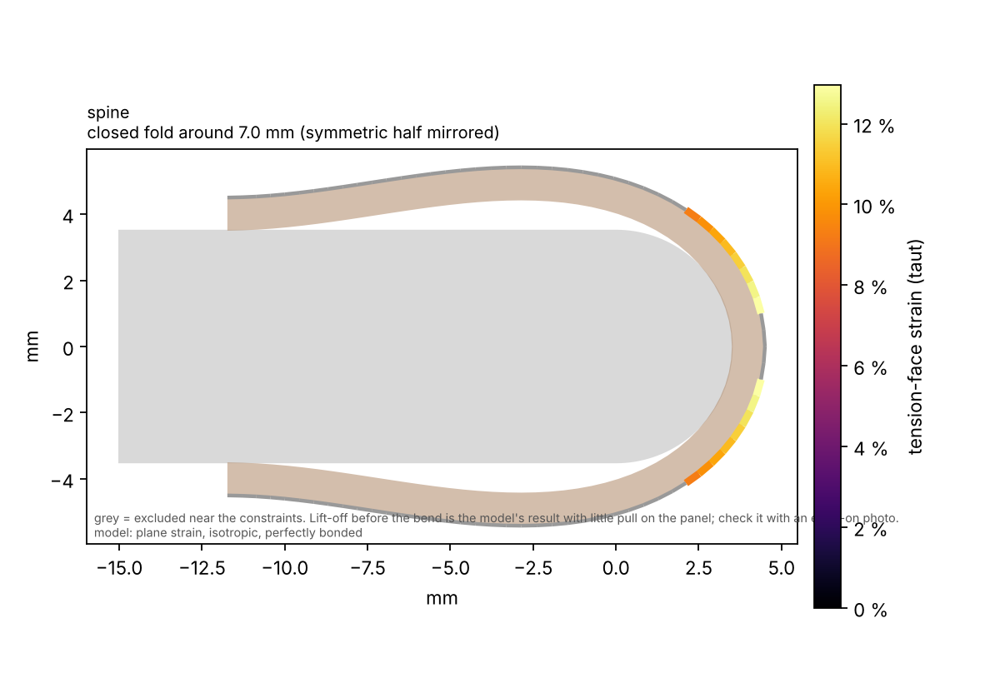
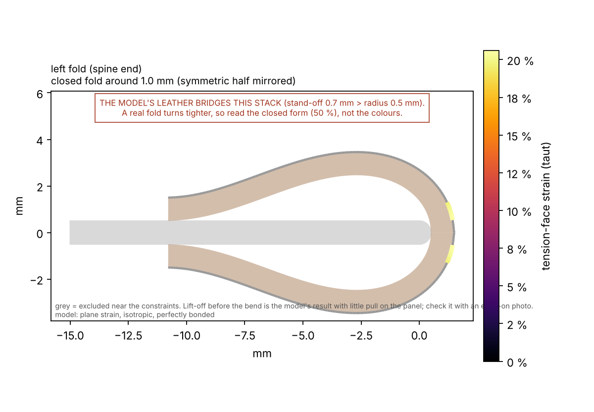
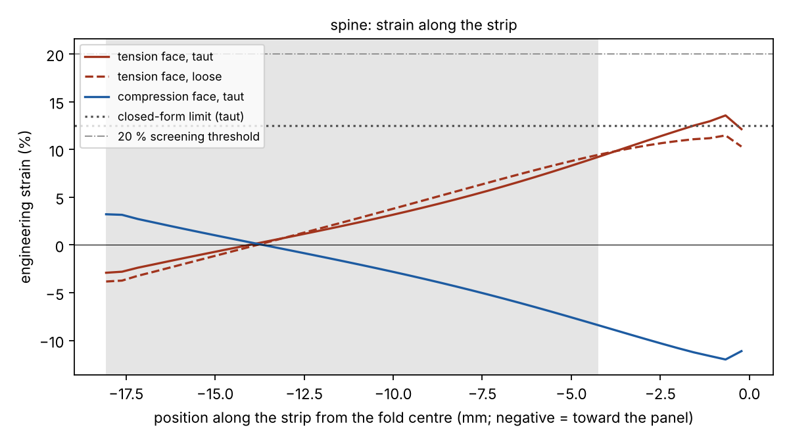
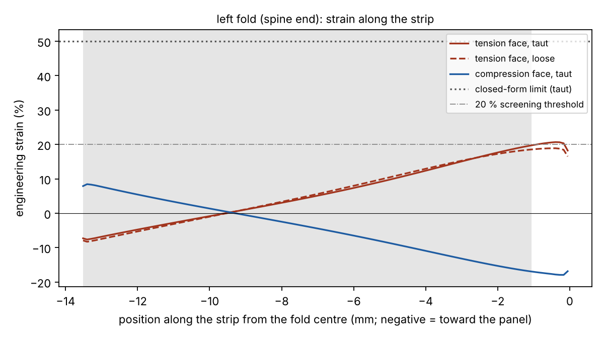
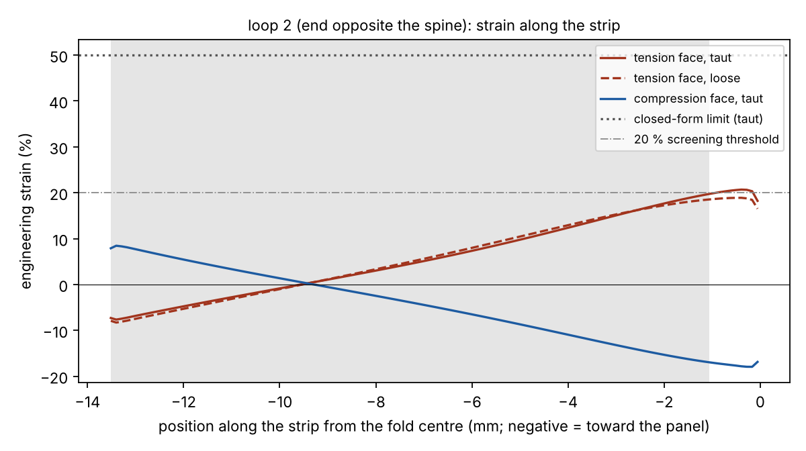

# M.A+ One Piece Wallet (W7 / W8 / W10): simulation report

> **This record comes from a retailer's text and product photographs, not from a wallet in hand.** Nothing is measured. Every radius and stack is an inference or an assumption, shown with its range. The results say what the model gives for those inputs, not what this wallet does.

- wallet: `ma-one-piece-wallet` (custom, 4 folds listed in the record, plain layup); status: photos-only
- inputs by source: 1 reported, 1 inferred, 1 literature, 8 assumed (of 11)
- model: walletsim 0.1.0, CalculiX ccx 2.21, plane-strain neo-Hookean fold, pull for 'taut' 0.1 N per mm; run `5258ea26`

## Inputs and where each came from

| input | value | source | what it changes | note |
|---|---|---|---|---|
| shell thickness | 1.0 mm | **reported** | strain at the fold (t / (2R + t)) and stiffness | retailer (Lucentement, corpus MAP03): 'one piece of 1 mm thick calf leather' |
| shell stiffness E | 72 MPa | **assumed** | closing moment (not strain) | placeholder: the tensile value measured for 1.2 mm calfskin (Mihai et al., Materials 2022, 15(15):5107); this  |
| Poisson's ratio | 0.3 - | **assumed** | small effect on moment |  |
| cards | 0  | **assumed** | the stack the spine wraps | photographed empty |
| card thickness | 0.76 mm | **literature** | the stack the spine wraps | ISO/IEC 7810 ID-1 nominal thickness |
| other contents | 0.0 mm | **assumed** | the stack the spine wraps |  |
| loop 1 (end opposite the spine): stack it wraps | 1.0 mm | **assumed** | the inside radius of this fold | the void inside the loop looks about one leather thickness across in the enlarged photograph; the upper bound  |
| left fold (spine end): stack it wraps | 1.0 mm | **assumed** | the inside radius of this fold | the hairpin between leaf A and leaf B, at the spine end; assumed to have the same void as the loops, since the |
| loop 2 (end opposite the spine): stack it wraps | 1.0 mm | **assumed** | the inside radius of this fold | as loop 1; it turns the same way as loop 1 (both are on the same side of the chain), so the grain is on the ou |
| inner leaves | 3  | **inferred** | the spine's stack (derived) | three inner leaves seen in the edge-on photographs |
| spine: stack it wraps (derived from the loops) | 7.0 mm | **assumed** | the inside radius of this fold | derived: 3 leaves x 1 mm + 4 gaps x 1 mm (the void inside 'loop 1 (end opposite the spine)'); layout inferred  |

Folds modelled (stack = what each fold wraps in the closed wallet; the range is what the sweep below covers). Closed thickness: not recorded.

| fold | grain | stack [mm] | range [mm] | source |
|---|---|---|---|---|
| spine | out | 7 | 5 to 19 | **assumed** |
| loop 1 (end opposite the spine) | out | 1 | 0.5 to 4 | **assumed** |
| left fold (spine end) | in | 1 | 0.5 to 4 | **assumed** |
| loop 2 (end opposite the spine) | out | 1 | 0.5 to 4 | **assumed** |

## The fold(s)

| fold | grain | stack [mm] | inside radius [mm] (R/t) | tension face, loose | taut | closed-form limit | grain face (taut) |
|---|---|---|---|---|---|---|---|
| spine | out | 7.00 | 3.50 (3.5) | 11.2 % | 13.0 % | 12.5 % | 13.0 % |
| loop 1 (end opposite the spine) | out | 1.00 | 0.50 (0.5) | 18.9 % (bridges) | 20.6 % (bridges) | 50.0 % | 20.6 % |
| left fold (spine end) | in | 1.00 | 0.50 (0.5) | 18.9 % (bridges) | 20.6 % (bridges) | 50.0 % | -17.7 % |
| loop 2 (end opposite the spine) | out | 1.00 | 0.50 (0.5) | 18.9 % (bridges) | 20.6 % (bridges) | 50.0 % | 20.6 % |

loose = the leather lies on the stack with no pull; taut = a pull of 0.1 N per mm on the panel; limit = the leather follows the stack exactly (closed form). A real wallet is somewhere between loose and the limit; an edge-on photo of the closed spine would show which.

In the figure the strip lifts off the stack before the bend. That is the model's result for leather with little or no pull on the panel; whether a real closed wallet does this is exactly what that edge-on photo would show.

**bridges** = with no pull the elastic model's leather stands further off the stack than the stack's radius, so it does not follow the stack: the FEM then understates the strain of leather that is pulled onto it (by a thread tie, by pressing or by the closed panels). Those folds are ranked by the closed form, shown next to the FEM numbers.

## How sure are we? Each fold across the range of its stack

The stacks are inferences or assumptions, so each fold is run at the low, recorded and high end of its range.

| fold | end of range | stack [mm] | inside radius (R/t) | tension face, loose | taut | closed form |
|---|---|---|---|---|---|---|
| spine | low | 5 | 2.50 (2.50) | 13.0 % | 14.5 % | 16.7 % |
| spine | recorded | 7 | 3.50 (3.50) | 11.2 % | 13.0 % | 12.5 % |
| spine | high | 19 | 9.50 (9.50) | 5.2 % | 5.3 % | 5.0 % |
| loop 1 (end opposite the spine) | low | 0.5 | 0.25 (0.25) | closed form only | | 66.7 % |
| loop 1 (end opposite the spine) | recorded | 1 | 0.50 (0.50) | 18.9 % (bridges) | 20.6 % (bridges) | 50.0 % |
| loop 1 (end opposite the spine) | high | 4 | 2.00 (2.00) | 14.0 % | 15.3 % | 20.0 % |
| left fold (spine end) | low | 0.5 | 0.25 (0.25) | closed form only | | 66.7 % |
| left fold (spine end) | recorded | 1 | 0.50 (0.50) | 18.9 % (bridges) | 20.6 % (bridges) | 50.0 % |
| left fold (spine end) | high | 4 | 2.00 (2.00) | 14.0 % | 15.3 % | 20.0 % |
| loop 2 (end opposite the spine) | low | 0.5 | 0.25 (0.25) | closed form only | | 66.7 % |
| loop 2 (end opposite the spine) | recorded | 1 | 0.50 (0.50) | 18.9 % (bridges) | 20.6 % (bridges) | 50.0 % |
| loop 2 (end opposite the spine) | high | 4 | 2.00 (2.00) | 14.0 % | 15.3 % | 20.0 % |

## Failure modes, in the order of `docs/FAILURE_MODES.md`

| # | mode | status | for this wallet |
|---|---|---|---|
| 1 | Grain crack at the hinge | **computed** | loop 1 (end opposite the spine): tension-face strain 18.9 % loose to 20.6 % taut (closed-form limit 50.0 %), inside radius 0.50 mm, R/t = 0.5; the model's leather bridges this stack, so the closed form is the number to read; inside radius below 1 x t: the grain relies on the finish to hold, expect cracking (R/t=0.50); outer-fibre strain >= 20 % (screening threshold, not a validated failure criterion). Cycles to crack need flex-test data. |
| 2 | Permanent set | **not modelled** | needs a cyclic viscoplastic model and fold-and-measure data; it is the usual first visible sign of a worn hinge |
| 3 | Finish crazing or delamination | **not modelled** | a film-on-substrate model quoted in prior-research/reference/durability.md section 2b has a stiff finish buckling at 2-12 % compressive strain; at loop 1 (end opposite the spine) the compression face is -17.7 % and the grain is in tension, not compression |
| 4 | Stress at stitch holes | **flagged** | stitching (thread ties) crosses or pins the fold(s): loop 1 (end opposite the spine), left fold (spine end), loop 2 (end opposite the spine). Holes in a bend remove part of the section there. No local model yet |
| 5 | Skive-line or thickness step | **unknown** | whether the folds are skived is not recorded; a skive line is a stiffness step where cracks start |
| 6 | Edge paint chipping | **unknown** | the edge treatment is not recorded; record it (painted edges chip where they flex) |
| 7 | Pocket-mouth and corner abrasion | **not modelled** | no pockets recorded (the photographs show some; they are not described yet); needs the card-pull scenario (roadmap phase 4) and wear photos to calibrate |
| 8 | Perforation tear line | **flagged** | holes through the fold(s) (their number is not recorded) |
| 9 | Layer delamination | **not modelled** | layers are treated as perfectly bonded; the record does not say what is glued |
| 10 | Cold embrittlement | **not modelled** | needs a cold flex test; no built-in factor |
| 11 | Wet and salt flex | **not modelled** | needs a wet flex test |
| 12 | Over-drying | **not modelled** | needs a measured material state (stiffness and strain to crack at a stated humidity) |
| 13 | Long-term chemical ageing | **not modelled** | ageing enters only through measured aged states; none recorded |
| 14 | Colour, patina, water spotting | **not modelled** | appearance only |

## What to measure first

1. **closed thickness and the layers at the spine**: Calipers across the closed wallet at the spine, and count the layers edge-on. It sets the spine's inside radius.
2. **the loops' inside radius**: Photograph each hairpin fold edge-on next to a ruler (or measure the gap with a caliper). The tight loops are the folds the model can only screen, and their radius decides everything.
3. **sheet thickness**: Calipers at 3 or more points along the sheet, away from the edges and folds; the retailer says 1 mm.
4. **how the folds are made**: Ask the maker whether the leather is skived or dampened at the folds, and what the thread ties do; both are unknown now.
5. **stiffness and ageing**: A bend test on an offcut or a worn sample gives the closing moment; fold-and-measure strips give permanent set.
6. **wear history**: If a used one is available: photographs of the loops and the spine, and how long and how it was carried.

## Reproduce

`walletsim wallet-report wallets/ma-one-piece-wallet` with walletsim 0.1.0. The exact `wallet.yaml` used is stored next to this report as `inputs.yaml`; every number above comes from `result.json`.
