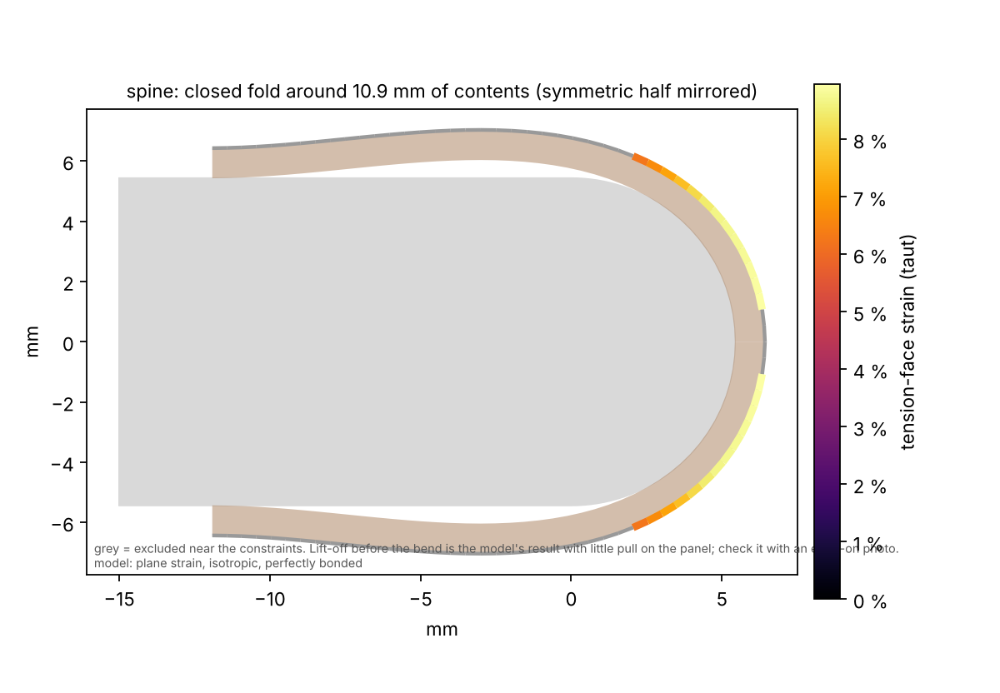
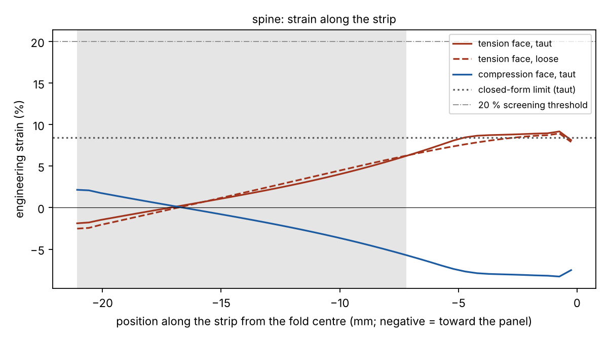

# Slim bifold, 6 cards (generated design): simulation report

> **This record is a design, not a measured wallet.** Numbers tagged `design` are what the pattern asks for and `assumed` are stand-ins; the physical wallet will differ. Read the results as what the model says *for this specification*, and replace the inputs as they are measured.

- wallet: `slim-6card-design` (bifold, round spine, plain layup), 6 cards
- inputs by source: 3 design, 1 literature, 5 assumed (of 9)
- model: walletsim 0.1.0, CalculiX ccx 2.21, plane-strain neo-Hookean fold, pull for 'taut' 0.1 N per mm; run `591f6ea5`

## Inputs and where each came from

| input | value | source | what it changes | note |
|---|---|---|---|---|
| shell thickness | 1.0 mm | **design** | strain at the fold (t / (2R + t)) and stiffness | source/report.json params.leather_t |
| slot-leather thickness | 0.7 mm | **design** | the stack the spine wraps | source/report.json params.slot_t |
| shell stiffness E | 72 MPa | **assumed** | closing moment (not strain) | placeholder: the tensile value measured for 1.2 mm calfskin (Mihai et al., Materials 2022, |
| Poisson's ratio | 0.3 - | **assumed** | small effect on moment |  |
| cards | 6  | **design** | the stack the spine wraps | source/report.json params.cards |
| card thickness | 0.76 mm | **literature** | the stack the spine wraps | ISO/IEC 7810 ID-1 nominal thickness |
| other contents | 0.0 mm | **assumed** | the stack the spine wraps | no notes |
| interior leather layers at the spine | 9  | **assumed** | the stack the spine wraps | pieces: 02_slot_bank x2, 03_slot_1..3 x2, 04_bill_divider |
| spine shape | round  | **assumed** | round or box-shaped end of the stack |  |

Stack the spine wraps: **10.86 mm** (6 cards x 0.76 mm + 9 interior leather layers x 0.7 mm, derived, source assumed). Closed wallet at the spine: 12.9 mm.

## The fold(s)

| fold | grain | stack [mm] | inside radius [mm] (R/t) | tension face, loose | taut | closed-form limit | grain face (taut) |
|---|---|---|---|---|---|---|---|
| spine | out | 10.86 | 5.43 (5.4) | 8.7 % | 9.0 % | 8.4 % | 9.0 % |

loose = the leather lies on the stack with no pull; taut = a pull of 0.1 N per mm on the panel; limit = the leather follows the stack exactly (closed form). A real wallet is somewhere between loose and the limit; an edge-on photo of the closed spine would show which.

In the figure the strip lifts off the stack before the bend. That is the model's result for leather with little or no pull on the panel; whether a real closed wallet does this is exactly what that edge-on photo would show.

## How sure are we? The stack is the least certain number

A 10 % larger stack lowers the textbook strain by about 9 %, and a 10 % thicker shell raises it by about 9 % (closed form). The stack is the number the design pins down least, and it is the one a caliper can settle.

| scenario | stack [mm] | R/t | tension face, loose | taut | limit |
|---|---|---|---|---|---|
| as recorded | 10.86 | 5.4 | 8.7 % | 9.0 % | 8.4 % |
| cards and other contents only (no interior leather) | 4.56 | 2.3 | 13.5 % | 15.0 % | 18.0 % |
| stack -30 % | 7.60 | 3.8 | 10.7 % | 12.3 % | 11.6 % |
| stack +30 % | 14.12 | 7.1 | 6.9 % | 7.0 % | 6.6 % |

## Failure modes, in the order of `docs/FAILURE_MODES.md`

| # | mode | status | for this wallet |
|---|---|---|---|
| 1 | Grain crack at the hinge | **computed** | spine: tension-face strain 8.7 % loose to 9.0 % taut (closed-form limit 8.4 %), inside radius 5.43 mm, R/t = 5.4; within the screening rules. Cycles to crack need flex-test data. |
| 2 | Permanent set | **not modelled** | needs a cyclic viscoplastic model and fold-and-measure data; it is the usual first visible sign of a worn hinge |
| 3 | Finish crazing or delamination | **not modelled** | a film-on-substrate model quoted in prior-research/reference/durability.md section 2b has a stiff finish buckling at 2-12 % compressive strain; the compression face of the spine is -8.2 % but the grain is in tension, not compression |
| 4 | Stress at stitch holes | **flagged** | the perimeter stitch line crosses the spine fold (spine); a row of holes across a bend removes most of the section there. No local model yet |
| 5 | Skive-line or thickness step | **not triggered** | the record says the spine is not skived; interior pieces step in height away from the fold, not across it |
| 6 | Edge paint chipping | **unknown** | the edge treatment is not recorded; record it (painted edges chip where they flex) |
| 7 | Pocket-mouth and corner abrasion | **not modelled** | 2 pocket(s) recorded; needs the card-pull scenario (roadmap phase 4) and wear photos to calibrate |
| 8 | Perforation tear line | **flagged** | 140 stitch holes in a line that crosses the fold |
| 9 | Layer delamination | **not modelled** | layers are treated as perfectly bonded; the record does not say what is glued |
| 10 | Cold embrittlement | **not modelled** | needs a cold flex test; no built-in factor |
| 11 | Wet and salt flex | **not modelled** | needs a wet flex test |
| 12 | Over-drying | **not modelled** | needs a measured material state (stiffness and strain to crack at a stated humidity) |
| 13 | Long-term chemical ageing | **not modelled** | ageing enters only through measured aged states; none recorded |
| 14 | Colour, patina, water spotting | **not modelled** | appearance only |

## What to measure first

1. **stack at the spine**: Measure the closed wallet's thickness at the spine with calipers (and its shell thickness); put it in `construction.closed_thickness_mm`. It sets the fold radius, which sets the strain.
2. **spine fold radius**: Photograph the closed spine edge-on against a ruler. The radius and the gap between leather and contents show how tightly the leather really sits on the stack (loose or taut).
3. **shell thickness**: Calipers at 3 or more points along the shell, away from edges.
4. **shell stiffness E**: A cantilever bend test on a strip, or any measurement of this leather; it sets the closing moment (not the strain).
5. **edge treatment and stitching**: Record the edge finish (painted, burnished, turned, bound) and whether stitching crosses the spine.
6. **wear history**: If it has been used: photographs of the spine and the pocket mouths, and roughly how long and how it was carried.

## Reproduce

`walletsim wallet-report wallets/slim-6card-design` with walletsim 0.1.0. The exact `wallet.yaml` used is stored next to this report as `inputs.yaml`; every number above comes from `result.json`.
