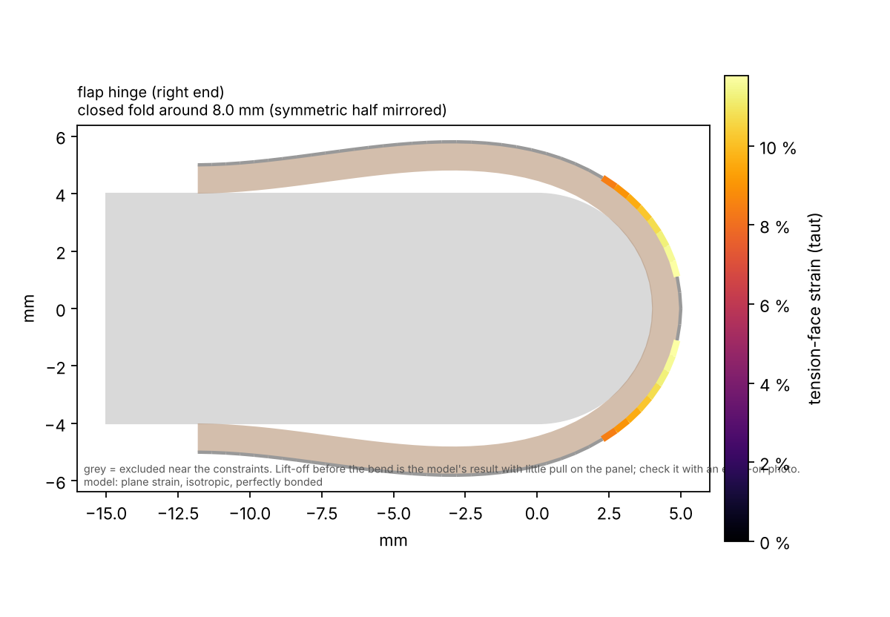
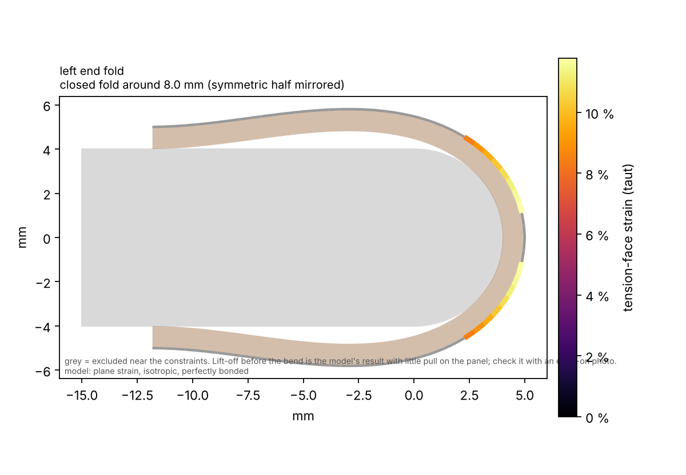
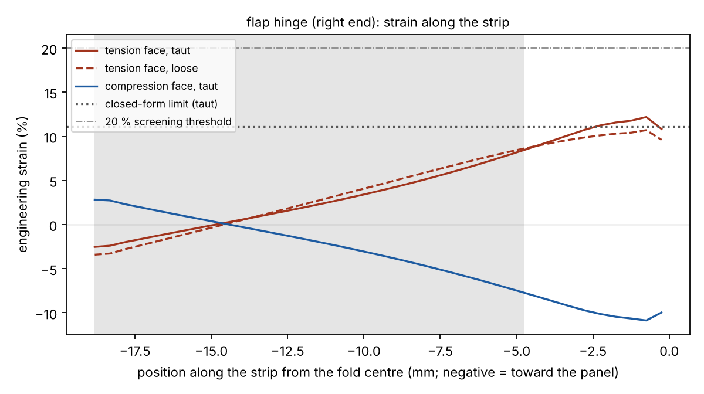
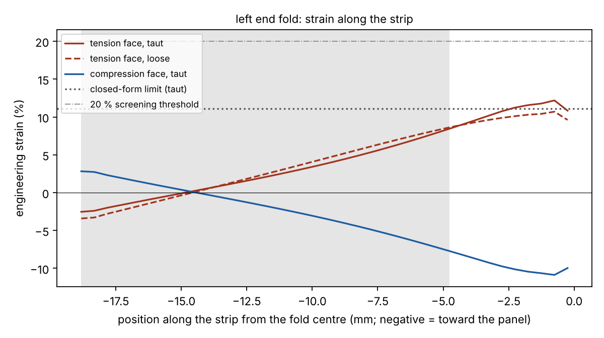

# Sruli Recht WHALET SR202 (EDITIONS reissue, 2022): simulation report

> **This record comes from a retailer's text and product photographs, not from a wallet in hand.** Nothing is measured. Every radius and stack is an inference or an assumption, shown with its range. The results say what the model gives for those inputs, not what this wallet does.

- wallet: `sr-whalet-sr202-2022` (custom, 2 folds listed in the record, plain layup); status: photos-only
- inputs by source: 2 reported, 1 literature, 7 assumed (of 10)
- leather: horse (equine) -> Horse, pony, donkey (sheet). Reference cards for this group: none. No card holds a strain at grain crack, so this report shows the strain each fold demands, not a margin against a limit.
- model: walletsim 0.1.0, CalculiX ccx 2.21, plane-strain neo-Hookean fold, pull for 'taut' 0.1 N per mm; run `6666bfd6`

## Inputs and where each came from

| input | value | source | what it changes | note |
|---|---|---|---|---|
| shell thickness | 1.0 mm | **assumed** | strain at the fold (t / (2R + t)) and stiffness | NOT STATED by the maker. A one-piece card wallet 10 mm deep closed; 1.0 mm is a stand-in for vegetable-tanned  |
| shell stiffness E | 72 MPa | **assumed** | closing moment (not strain) | placeholder: the tensile value measured for 1.2 mm CALFskin (Mihai et al., Materials 2022, 15(15):5107); no ho |
| Poisson's ratio | 0.3 - | **assumed** | small effect on moment |  |
| cards | 0  | **assumed** | the stack the spine wraps | the 10 mm depth is the maker's figure; whether it was taken empty is not stated |
| card thickness | 0.76 mm | **literature** | the stack the spine wraps | ISO/IEC 7810 ID-1 nominal thickness |
| other contents | 0.0 mm | **assumed** | the stack the spine wraps |  |
| closed thickness at the spine | 10.0 mm | **reported** | the inside radius of the spine fold (stack = closed thickness - 2 x shell) | maker's page (corpus SRW11): 'Dimensions of WHALET - 85 mm x 100 mm x 10 mm'. Not checked, and not said whethe |
| flap hinge (right end): stack it wraps (derived from the closed thickness) | 8.0 mm | **assumed** | the inside radius of this fold | derived: closed thickness 10 mm - 2 x 1 mm of shell; the lower bound 4 mm is assumed (the pack compresses). th |
| left end fold: stack it wraps (derived from the closed thickness) | 8.0 mm | **assumed** | the inside radius of this fold | derived: closed thickness 10 mm - 2 x 1 mm of shell; the lower bound 4 mm is assumed (the pack compresses). th |
| closed thickness | 10.0 mm | **reported** | report only | maker's page (corpus SRW11): 'Dimensions of WHALET - 85 mm x 100 mm x 10 mm'. Not checked, and not said whethe |

Folds modelled (stack = what each fold wraps in the closed wallet; the range is what the sweep below covers). Closed thickness: 10.0 mm.

| fold | grain | stack [mm] | range [mm] | source |
|---|---|---|---|---|
| flap hinge (right end) | out | 8 | 4 to 8 | **assumed** |
| left end fold | out | 8 | 4 to 8 | **assumed** |

## The fold(s)

| fold | grain | stack [mm] | inside radius [mm] (R/t) | tension face, loose | taut | closed-form limit | grain face (taut) |
|---|---|---|---|---|---|---|---|
| flap hinge (right end) | out | 8.00 | 4.00 (4.0) | 10.4 % | 11.8 % | 11.1 % | 11.8 % |
| left end fold | out | 8.00 | 4.00 (4.0) | 10.4 % | 11.8 % | 11.1 % | 11.8 % |

loose = the leather lies on the stack with no pull; taut = a pull of 0.1 N per mm on the panel; limit = the leather follows the stack exactly (closed form). A real wallet is somewhere between loose and the limit; an edge-on photo of the closed spine would show which.

In the figure the strip lifts off the stack before the bend. That is the model's result for leather with little or no pull on the panel; whether a real closed wallet does this is exactly what that edge-on photo would show.

## How sure are we? Each fold across the range of its stack

The stacks are inferences or assumptions, so each fold is run at the low, recorded and high end of its range.

| fold | end of range | stack [mm] | inside radius (R/t) | tension face, loose | taut | closed form |
|---|---|---|---|---|---|---|
| flap hinge (right end) | low | 4 | 2.00 (2.00) | 14.0 % | 15.3 % | 20.0 % |
| flap hinge (right end) | recorded | 8 | 4.00 (4.00) | 10.4 % | 11.8 % | 11.1 % |
| left end fold | low | 4 | 2.00 (2.00) | 14.0 % | 15.3 % | 20.0 % |
| left end fold | recorded | 8 | 4.00 (4.00) | 10.4 % | 11.8 % | 11.1 % |

## Failure modes, in the order of `docs/FAILURE_MODES.md`

| # | mode | status | for this wallet |
|---|---|---|---|
| 1 | Grain crack at the hinge | **computed** | flap hinge (right end): tension-face strain 10.4 % loose to 11.8 % taut (closed-form limit 11.1 %), inside radius 4.00 mm, R/t = 4.0; within the screening rules. Cycles to crack need flex-test data. |
| 2 | Permanent set | **not modelled** | needs a cyclic viscoplastic model and fold-and-measure data; it is the usual first visible sign of a worn hinge |
| 3 | Finish crazing or delamination | **not modelled** | a film-on-substrate model quoted in prior-research/reference/durability.md section 2b has a stiff finish buckling at 2-12 % compressive strain; at flap hinge (right end) the compression face is -10.6 % and the grain is in tension, not compression |
| 4 | Stress at stitch holes | **unknown** | the record lists rivets, but whether it crosses or pins a fold is not recorded |
| 5 | Skive-line or thickness step | **unknown** | whether the folds are skived is not recorded; a skive line is a stiffness step where cracks start |
| 6 | Edge paint chipping | **unknown** | the edge treatment is not recorded; record it (painted edges chip where they flex) |
| 7 | Pocket-mouth and corner abrasion | **not modelled** | 2 pocket(s) recorded; needs the card-pull scenario (roadmap phase 4) and wear photos to calibrate |
| 8 | Perforation tear line | **unknown** | no recorded row of holes crosses a fold |
| 9 | Layer delamination | **not modelled** | layers are treated as perfectly bonded; the record does not say what is glued |
| 10 | Cold embrittlement | **not modelled** | needs a cold flex test; no built-in factor |
| 11 | Wet and salt flex | **not modelled** | needs a wet flex test |
| 12 | Over-drying | **not modelled** | needs a measured material state (stiffness and strain to crack at a stated humidity) |
| 13 | Long-term chemical ageing | **not modelled** | ageing enters only through measured aged states; none recorded |
| 14 | Colour, patina, water spotting | **not modelled** | appearance only |

## What to measure first

1. **closed thickness, and how much of it the main fold wraps**: Calipers across the closed wallet at the spine, edge-on photographs with a ruler, and a count of the layers. The depth now on record is the seller's hand measurement; the pockets, the cards and the bills all add to it, and nothing says how much of that depth the main fold turns round.
2. **the gusset creases**: Photograph one side pleat of the bill pocket edge-on against a ruler, empty and with a few bills in it. Their radius is only assumed here, and it decides the tightest fold in the model.
3. **sheet thickness**: Calipers at 3 or more points along the sheet, away from the edges and folds; the listing says 1 mm.
4. **where the stitching goes**: Record which seams cross or pin a fold; the listing says only that the wallet has hand-stitched details.
5. **stiffness and ageing**: No tensile or bend test of this leather exists. Any test on an offcut or a worn sample gives the closing moment; the calf value in use is a placeholder, and pig leather differs.
6. **wear history**: The seller's photograph of the flap shows light abrasion. Photograph the wear at the folds and pocket mouths with a ruler, and note how long and how it was carried.

## Reproduce

`walletsim wallet-report wallets/sr-whalet-sr202-2022` with walletsim 0.1.0. The exact `wallet.yaml` used is stored next to this report as `inputs.yaml`; every number above comes from `result.json`.
